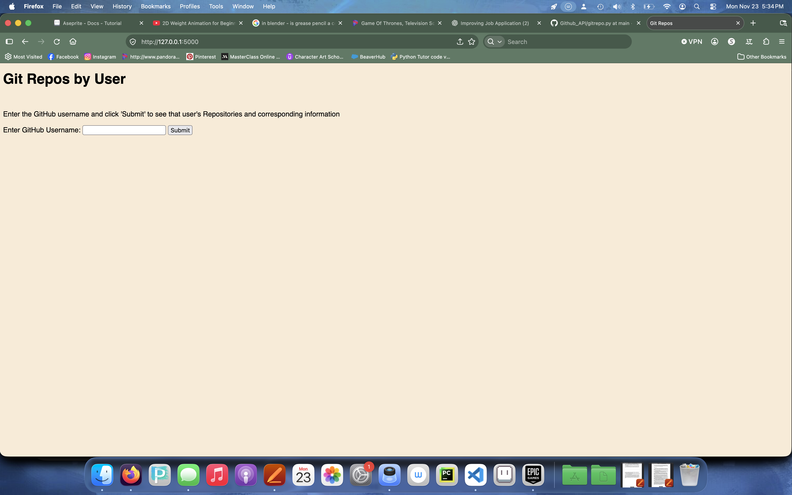
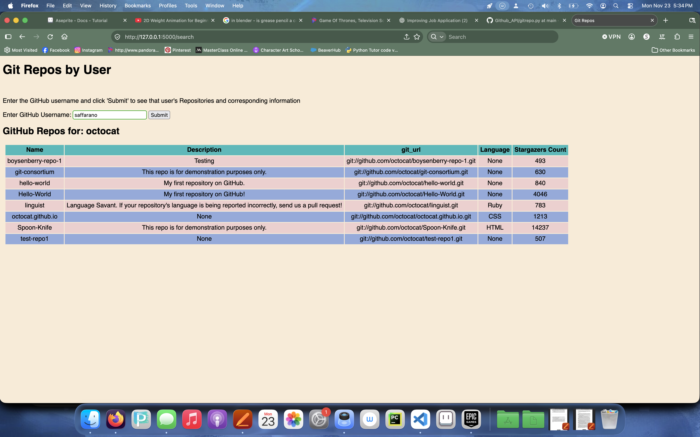
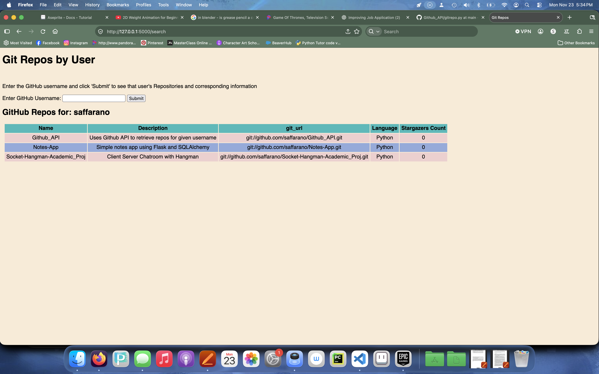

## Github_API
Web application accepts a Github username and uses the GitHub API that user's public repositories. Flask routes call API, retrieves and filters JSON and passes to Jinja templates to display the information.

## Tech Stack:
- Flask
- Python
- Jinja2
- HTML / CSS

## How to run:
- python -m venv venv
- Source venv/bin/activate  # or venv/Scripts/Activate on Windows
- pip install -r requirements.txt
- python gitrepo.py

## Screenshots:

- Home Page:

- Repositores:

- New Search

- Updated View:

